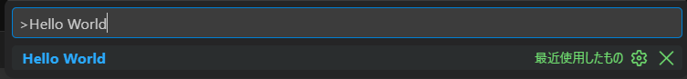
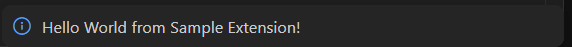

## 概要

本稿では、VSCode拡張機能を作る際の環境構築について案内します。

## 前提条件

- `Node.js`がインストールされている
- `npm`/`pnpm`または`yarn`がインストールされている
- `TypeScript`または`JavaScript`の基礎構文がわかる
- VSCodeを利用できる

> パッケージングツールは`pnpm`を例に進めますが、他のものでも手順は同じです


## 拡張機能の作成方法

最初に、作業ディレクトリに移動しておきます。

例えば、`vscode-extensions`などのディレクトリを作って、移動しておきます。


### 1. 雛形作成

以下のコマンドを叩きます。

```sh
npx -p yo -p generator-code yo code
```

すると、対話式に項目が提示されます。

#### i: 拡張機能のタイプ
ここでは、「TypeScriptを使った拡張機能」を作ります。

```sh
? What type of extension do you want to create?
❯ New Extension (TypeScript)
  New Extension (JavaScript)
  New Color Theme
  New Language Support
  New Code Snippets
  New Keymap
  New Extension Pack
  New Language Pack (Localization)
  New Web Extension (TypeScript)
  New Notebook Renderer (TypeScript)
```

#### ii: 拡張機能の名前

```sh
? What's the name of your extension? Sample Extension
```

#### iii: 識別子
拡張機能に対して一意な識別子を付けます。
基本的に、そのままEnterして問題ありません。

```sh
? What's the identifier of your extension? (sample-extension)
```

#### iv: 詳細情報
拡張機能の主な機能紹介など、詳細情報を書きます。

```sh
? What's the description of your extension? This is a simple sample extension.
```

#### v: リポジトリの初期化
既存のリポジトリを謝って初期化しないように注意してください。

```sh
? Initialize a git repository? (Y/n)
```

#### vi: バンドラーの選択

新規開発であれば、`esbuild`が標準です。（Microsoft公式が推奨）

```sh
? Which bundler to use?
  unbundled
  webpack
❯ esbuild
```

#### vii: パッケージングツールの選択

ここではpnpmを使っています。
これについては、運用方針に従ってください。

```sh
? Which package manager to use?
  npm
  yarn
❯ pnpm
```

### 2. 開発手順

環境構築が完了したので、実際に拡張機能を動かします。

まずは、先ほど作成されたディレクトリ（sample-extension）をVSCodeで開きます。


#### ビルド

以下のコマンドで、ビルドを行います。
```sh
pnpm watch
# watchモードが動いている間、コード変更の際に自動でビルドが走ります（ホットリロード）
```

#### デバッグ起動
`F5`キーを押します。

デバッグが起動すると、ウィンドウが新しく開かれるのでそちらでデバッグします。

#### デバッグ
まず、`Ctrl + Shift + P`（Macは `Cmd + Shift + P`）を押します。

`package.json`に定義されている、`contributes.commands`には`Hello World`が用意されているので、これを使います。

```json
{
  ...
  "contributes": {
    "commands": [
      {
        "command": "sample-extension.helloWorld",
        "title": "Hello World"
      }
    ]
  },
  ...
}
```



成功すると、以下の様な通知が右下に出ます。


`/src/extensions.ts`にあるコードが動いて通知が出ています。

```ts
import * as vscode from 'vscode';

export function activate(context: vscode.ExtensionContext) {
  console.log('Congratulations, your extension "sample-extension" is now active!');

  const disposable = vscode.commands.registerCommand('sample-extension.helloWorld', () => {
    // 以下のコードが動作し、ポップアップ通知が表示されます
    vscode.window.showInformationMessage('Hello World from Sample Extension!');
  });

  context.subscriptions.push(disposable);
}

export function deactivate() {}
```

環境構築・デバッグ手順は、以上となります。
